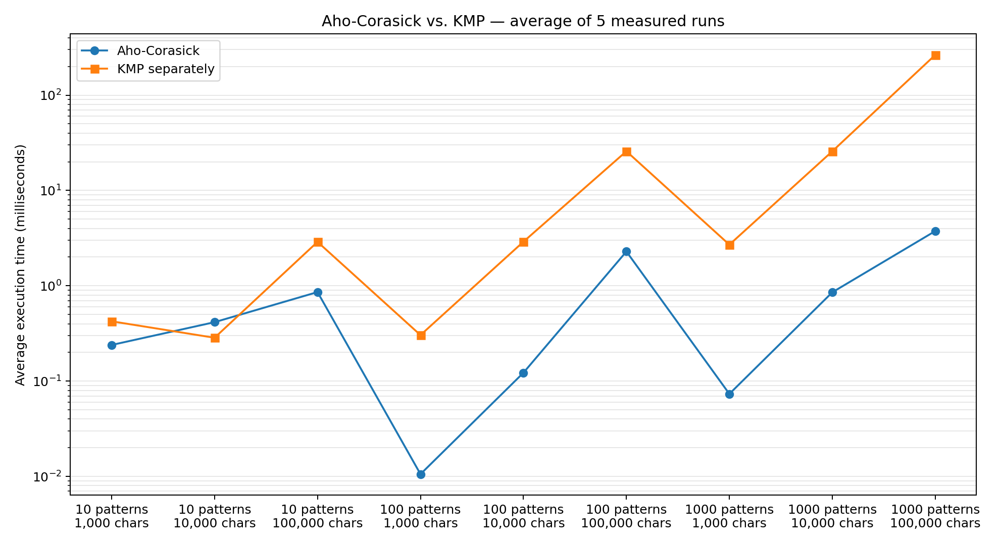

# Aho–Corasick
Project Overview

This project implements the Aho–Corasick multiple pattern matching algorithm in Java. It searches for several patterns simultaneously in a given text. The project also compares its performance with the Knuth–Morris–Pratt (KMP) algorithm using different numbers of patterns and text lengths.
## Project Structure
```text
AhoCorasickProject/
├── java/
│   ├── AhoCorasick.java
│   ├── KMP.java
│   ├── Benchmark.java
│   ├── Example.java
│   └── TestAhoCorasick.java
├── results/
│   └── benchmark_results.csv
├── benchmark_graph.png
└── README.md
```
**File Description**
- `AhoCorasick.java` – Implements the Trie, failure links, output links, and pattern searching.
- `KMP.java` – Implements KMP for performance comparison.
- `Benchmark.java` – Runs nine performance experiments.
- `Example.java` – Demonstrates the algorithm.
- `TestAhoCorasick.java` – Tests overlapping matches, suffix matches, and duplicate patterns.
- `benchmark_results.csv` – Stores average execution times.
- `benchmark_graph.png` – Shows the performance comparison.
## How to Compile and Run
Run these commands from the project root:
```bash
javac -d out java/*.java
java -cp out Example
java -cp out TestAhoCorasick
java -cp out Benchmark
```
The benchmark generates deterministic random lowercase patterns and texts. It measures execution time using `System.nanoTime()`. Each experiment is repeated five times, and the average execution time is calculated. Pattern and text generation are outside the timed search section.
## How the Aho–Corasick Algorithm Works
Aho–Corasick is an algorithm that searches for multiple patterns in a text during a single traversal. First, all patterns are inserted into a Trie. Each edge represents a character, and each terminal node represents the end of a pattern. Patterns with common prefixes share the same path in the Trie, reducing duplicated storage.
After building the Trie, failure links are constructed using Breadth-First Search (BFS). A failure link points to the longest proper suffix of the current string that is also a prefix in the Trie. The root's children have failure links pointing to the root. For deeper nodes, the algorithm follows the failure links of the parent until it finds a valid transition. If no transition exists, the failure link points to the root.
Output links help the algorithm find patterns that end at suffix nodes. For example, when the pattern `she` is matched, the algorithm can also report `he`, because it is a suffix of `she`.
During searching, the algorithm reads each text character once. If the current state does not contain a matching transition, it follows failure links until a valid transition is found or the root is reached. Whenever a pattern is matched, its occurrence and position in the text are reported.
## Time and Space Complexity
Let `P` be the total length of all patterns, `N` the text length, `K` the number of patterns, and `Z` the number of reported matches.
- Trie construction: O(P) expected time.
- Failure link construction: O(P) expected time for a fixed alphabet and sparse-trie implementation.
- Searching: O(N + Z).
- Total time complexity: O(P + N + Z).
- Space complexity: O(P) for the Trie, failure links, output links, and pattern references. Storing all results requires an additional O(Z) space.
## Comparison with KMP
KMP searches for one pattern at a time. For a pattern of length M and a text of length N, its time complexity is O(N + M). Running KMP separately for K patterns takes O(KN + P) time.
Aho–Corasick is more suitable when many patterns must be searched in the same text because it scans the text once. KMP is simpler and requires less memory for a single pattern, while Aho–Corasick requires additional preprocessing and memory.
## Experimental Setup
The experiments use three pattern counts: 10, 100, and 1,000. Three text lengths are tested: 1,000, 10,000, and 100,000 characters. This produces nine test configurations. Each configuration is executed five times using `System.nanoTime()`, and the arithmetic mean is recorded. The Aho–Corasick automaton is built once per pattern set and reused for the corresponding text lengths. KMP searches for every pattern separately.
## Experimental Results
The table shows the measured average execution times in milliseconds.
| Patterns | Text Length | Aho–Corasick (ms) | KMP (ms) |
|---:|---:|---:|---:|
| 10 | 1,000 | 0.239 | 0.424 |
| 10 | 10,000 | 0.415 | 0.285 |
| 10 | 100,000 | 0.859 | 2.890 |
| 100 | 1,000 | 0.011 | 0.304 |
| 100 | 10,000 | 0.122 | 2.901 |
| 100 | 100,000 | 2.290 | 25.797 |
| 1,000 | 1,000 | 0.073 | 2.700 |
| 1,000 | 10,000 | 0.855 | 25.785 |
| 1,000 | 100,000 | 3.753 | 264.610 |
## Performance Comparison Graph
The following graph compares the average execution times of both algorithms for all nine configurations.

## Graph Analysis and Discussion
The graph uses a logarithmic vertical scale because the execution times differ significantly between the algorithms.
With 10 patterns, both algorithms show relatively close performance. For 1,000 characters, Aho–Corasick takes 0.239 ms, while KMP takes 0.424 ms. For 10,000 characters, KMP is slightly faster: 0.285 ms compared to 0.415 ms. This may be caused by preprocessing overhead and measurement variations. However, for 100,000 characters, Aho–Corasick is approximately 3.4 times faster.
With 100 patterns and 100,000 text characters, Aho–Corasick takes 2.290 ms, while KMP takes 25.797 ms. This demonstrates the advantage of processing the text in one pass instead of repeating the search for every pattern.
The largest difference appears with 1,000 patterns and 100,000 characters. Aho–Corasick takes 3.753 ms, while KMP takes 264.610 ms. Therefore, Aho–Corasick is approximately 70 times faster in this experiment.
Overall, the graph shows that the performance advantage of Aho–Corasick becomes more significant as the number of patterns and text length increase. KMP performs well for a single pattern, but repeated searches become expensive when many patterns are used.
## Conclusion
The experiment demonstrates that Aho–Corasick is an efficient algorithm for multiple pattern matching. Its main advantage is that it combines all patterns into one Trie and uses failure links to avoid restarting the search from the beginning.
KMP remains a good choice for searching for a single pattern because it is simple and has low memory requirements. Aho–Corasick requires more memory and preprocessing, but it provides better performance when searching for many patterns in the same text.
The measured execution times depend on the computer, Java runtime, JVM warm-up, and system load. Therefore, the results represent observations from this experiment rather than universal performance guarantees.